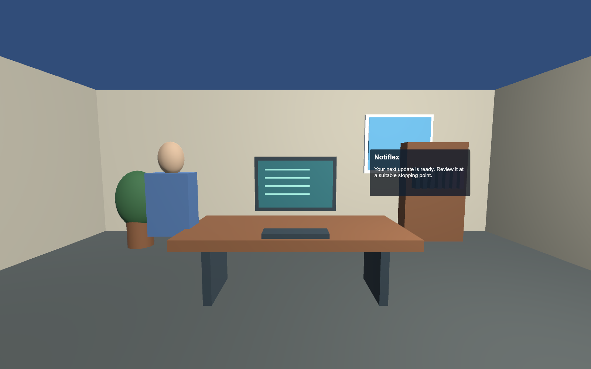

# Notiflex VR research prototype

A Unity application for studying context-aware XR notification placement. It includes three authored 3D test rooms—Desk, Kitchen and LivingRoom—and a separate Quest Passthrough scene that renders notifications over the live room. The headset view has no desktop control panel.

The system scores eligible visual candidates for interruption, projected occlusion and social disengagement, selects a position, then separately selects full visual, peripheral cue, positional chime or deferred delivery. Head direction is an attention proxy. Activity modes, task references and conversation partner annotations are explicitly supplied; automatic camera understanding, conversational sensing and eye tracking are not implemented.

Download the APK, universal Mac player and manual from the [v0.3.0 development release](https://github.com/AaronJoseph-34/notiflex/releases/tag/v0.3.0). Physical Quest acceptance is pending.

## Start here

- [Quest 3S capabilities and implementation boundaries](docs/PLATFORM.md)
- [Install, controls and test scenarios](docs/INSTALL-AND-TEST.md)
- [Complete notification rules](docs/NOTIFICATION-RULES.md) · [Word manual](docs/Notiflex-Notification-Rules.docx)
- [Validation report and hardware gates](docs/VALIDATION.md)
- [Implementation plan](docs/IMPLEMENTATION-PLAN.md)
- [Evidence](evidence/): test results, candidate scores and diagnostic renderings

## Build from source

Open `UnityProject` with **Unity 6000.4.7f1** and install its Android Build Support, SDK/NDK and OpenJDK modules. The project restores pinned OpenXR 1.19.0, Meta XR Core 209.0.0 and Unity MCP v10.3.0 packages. Meta's registry and GitHub need internet access on first import.

Unity menu **Notiflex → Build authored environments** regenerates the four scenes. **Notiflex → Configure Quest build** sets Android ARM64/IL2CPP, OpenGLES3, SDK minimum 32/target 35, OpenXR and Meta passthrough support. Regenerating scenes overwrites their authored contents; keep scene edits in source control first.

From a terminal, with `UNITY` pointing to the Unity executable:

```sh
"$UNITY" -batchmode -nographics -quit -projectPath "$PWD/UnityProject" \
  -executeMethod Notiflex.VR.Editor.PlatformBuilder.BuildMac -logFile mac-build.log
"$UNITY" -batchmode -nographics -quit -buildTarget Android -projectPath "$PWD/UnityProject" \
  -executeMethod Notiflex.VR.Editor.PlatformBuilder.BuildAndroid -logFile android-build.log
```

Outputs are `Builds/NotiflexVR.app` and `Builds/NotiflexVR.apk` beside this README. Both are development builds for research diagnostics; the APK uses a development signing key. The Mac package is a local prototype, not a notarized App Store distribution.

## Tests and Unity MCP

The Unity Test Runner has three EditMode groups: policy/normalized costs, 486 room/viewpoint/context/urgency scenarios, and explicit geometry/tracking failure cases. Select **Window → General → Test Runner → EditMode → Run All**, or use Unity's `-runTests -testPlatform EditMode -testResults results.xml` command-line options.

Unity MCP was used for scene authoring/configuration, hierarchy inspection and test execution. To reproduce: start the installed Unity MCP bridge using its supported editor UI or `MCPForUnity.Editor.McpCiBoot.StartStdioForCi`, install the matching `mcp-for-unity` Python server, then use `tools/mcp_call.py` with `UNITY_MCP_SERVER` set to that executable. Use only trusted local clients; no public bridge service is required.

The desktop player's opt-in lifecycle audit runs with `--notiflex-audit`; `NOTIFLEX_AUDIT_OUTPUT` chooses the output directory. It loads all scenes, exercises context dwell, delivery, reading and dismissal, and saves offscreen frames. Ordinary launches never activate the audit.

## Technical scope

`PlacementPolicy` contains pure rules and profiles; `SpatialEvaluator` evaluates the finite candidate set and geometric constraints; `ContextDwell` filters activity changes; `NotiflexRuntime` integrates tracked/simulated head pose, controller input, lifecycle and JSONL diagnostics; `NotificationView` draws a world-space panel. The full equations, units, thresholds, precedence and limitations are in the rules manual.

These cost functions are auditable implementation hypotheses based on the supplied paper. Software tests verify their implementation; they do not establish empirically optimal weights or human performance. Physical Quest 3S acceptance remains a separate test step.



Desktop simulation evidence; live-room passthrough requires the Quest package and physical headset acceptance.
